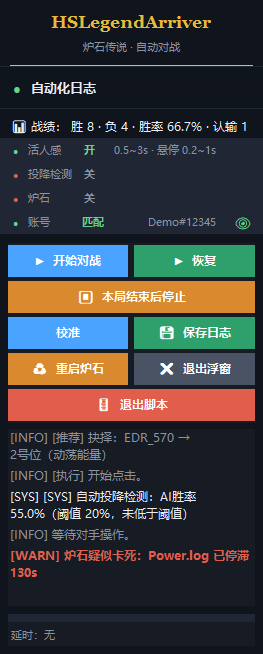

<div align="center">

# 🏆 HSLegendArriver（胜率 63.8 的炉石传说脚本）

### 帮你走完上传说的路

**读取炉石日志 + 获取炉石盒子打法建议 + 自动执行操作**

**33 分钟：钻石 2 → 传说** ｜ **一下午：冲到传说约 6000 名**

> 🔥 已实测支持：**机械骑 / 号角骑 / 弃牌术 / 海盗瞎**  
> 🩺 无人值守安全：炉石闪退 / 卡死会醒目告警并**自动停止**，不会对着失效画面空转到天亮  
> 🧪 第一次启动就自检：Python 版本、依赖、管理员权限、分辨率逐项 ✅/❌  
> 🌿 **抉择 / 发现两步牌**：选完选项自动接着点目标（暮光侵扰、凶险梦魇、调酒师鲍勃「招募随从」）  
> 🔍 **卡死可追**：识别失败时日志会打出推荐原文与 OCR 原文，不用再靠猜


</div>

> 网页控制台（界面示意，你机器上的数值会不同）：顶部是运行概览与环境自检，往下依次是基础配置、定时任务、对战控制、存活检测、自动投降、上分停止、活人感、延时设置、校准区域、实时日志。
>
> 📝 **更新日志**：[CHANGELOG.md](CHANGELOG.md)（最近一次 2026-10-08：浮窗重开修复、日志体积与一键清理、校准卡片重排）。

---

## ⚠️ 先看三条（最容易翻车的配置）

| # | 要求                                             | 不满足会怎样                                                                    |
| - | ---------------------------------------------- | ------------------------------------------------------------------------- |
| 1 | **Python 必须 3.12（64 位）**                       | 装成 3.13/3.14 时，脚本能点「开始游戏」，但一进对局就卡在换牌、AI 识别全不工作（paddlepaddle 没有 3.13+ 的轮子） |
| 2 | 客户区比例 **16:9**（**缩放不限**，脚本已声明 DPI 感知）        | 客户区不是 16:9 时按比例换算会把画面横向拉偏                                              |
| 3 | 炉石窗口可放桌面任意位置，**客户区保持 16:9**（全屏、或任意 16:9 的窗口尺寸） | 客户区是别的比例时点击会横向拉偏；客户区小于 960×540 时盒子面板会被挤出屏幕                                |

> 分辨率**不再有要求**：脚本按「炉石客户区几何」实时换算所有坐标（见  
> [坐标换算](#-坐标换算客户区--屏幕)），4K / 2K / 1080p 都能跑，窗口也不必贴屏幕左上角。  
> 还有一条：项目路径**不要有中文字符**（OCR 与依赖对中文路径支持不好）。

---

## 🚀 安装（5 步）

### 1. 装 Python 3.12

到 <https://www.python.org/downloads/> 下载 **Python 3.12**，安装时**务必勾选 `Add python.exe to PATH`**。  
装完在 PowerShell 里 `python --version` 确认是 3.12。

### 2. 装依赖（清华镜像）

在项目根目录右键打开 PowerShell：

```powershell
pip install -r requirements.txt -i https://pypi.tuna.tsinghua.edu.cn/simple
```

依赖较大（含 PaddleOCR / PaddlePaddle），耐心等。

### 3. 以管理员身份启动

**必须用管理员 PowerShell**（否则鼠标点击会被系统拦掉，现象是「脚本在跑但点了没反应」）：

```powershell
cd 项目根目录
python web_ui.py
```

浏览器会自动打开 **`http://127.0.0.1:8765`**；端口被占用时会自动往后换（8765–8785），以控制台打印为准。

> 想省掉每次手动提权（尤其是要用手机/agent 远程启动）？用命令行版注册一个"最高权限"  
> 计划任务，之后启动不再弹 UAC：见 [`docs/CLI.md`](docs/CLI.md) 第 5 节，或直接  
> `python hsctl.py serve install-task`（需管理员跑一次）。

### 4. 打开炉石 + 炉石盒子

盒子用**简体中文**，左侧「推荐打法」面板要完整显示、不被别的窗口遮挡。

### 5. 把环境固定下来（换机器 / 换 agent 必看）

路径、解释器**因机器而异**，千万不要写死在代码或文档里。本机专属配置统一放  
`log/env.json`（**已被 `.gitignore` 忽略**，不会进仓库；仓库里只有占位符模板  
`env.example.json`）。会话第一条命令跑自诊，照它给的下一步做：

```powershell
python hsctl.py --json doctor                  # 看 verdict：环境对不对 / 控制台在不在 / 下一步做什么
python hsctl.py env discover                   # 列出本机候选解释器（版本 + 依赖逐项校验，不写盘）
python hsctl.py env pin "C:\你的Python3.12\python.exe"   # 选定并保存到 log/env.json（换成你实际的路径）
python hsctl.py --json doctor                  # 复验到 verdict=env_ok
```

解释器查找顺序是唯一权威的：`HS_PYTHON` 环境变量 → `log/env.json` → 当前解释器  
（校验通过才用）→ 自动探测候选。**任何** Python 跑 `hsctl` 时，若当前解释器不合格  
会自动重入到合格的那个；一个都不合格则退出码 `4`。所以 agent 不需要手工切环境。

> 计划任务启动器用的解释器也以 `log/env.json` 为准，换机器只需重跑上面这 4 条，  
> 不用手改任何 `.cmd`。

---

## 🎮 使用（5 步）

### 1. 填账号与日志目录

网页「👤 基础配置」里两项都不能少：

| 项      | 填什么                                                         |
| ------ | ----------------------------------------------------------- |
| 用户 ID  | **当前账号完整的战网昵称，含 `#编号`**（换账号一定要同步改）。填错或不填 → 脚本读不出「我是谁」，整局不出牌 |
| 炉石日志目录 | 炉石安装目录下的 `Logs` 文件夹，例如 `D:\Hearthstone\Logs`。点旁边的 [检测] 可以验证 |

### 2. 校准盒子面板（只需一次）

点「🎯 校准区域」卡片里的 **[📐 打开校准窗口（屏幕上）]**，把**绿框**拖到盒子「打法参考A」面板上，看到提示条变成绿色「已检测到盒子面板」即可，按 **S**（或点卡片底部的 **「保存全部区域」**）保存，12 个目标一起存；点 **「退出」** 或按 **Esc** 关掉窗口。

### 3. 看「🧪 环境自检」

页面顶部那张卡片每项一行：✅ 达标、⚠️ 和推荐值不同（还能跑）、❌ 不满足（**必须先修**）。缺依赖会直接给 pip 命令。

### 4. 开始运行（准备）

点 **[🪄 开始运行（准备）]**：只打开右上角日志浮窗 + 把炉石切到前台，**不会自动开打**。确认浮窗上「账号」显示**匹配**（不是匹配就先改用户 ID）。

### 5. 开始对战

点 **[⚔️ 开始对战]**（或浮窗上的 **[▶ 开始对战]**）：脚本开始按盒子推荐出牌。想停就点 **[立即停止]** 或按 **Ctrl+Q**。



> **右上角实时日志浮窗**（263×693，半透明置顶）：顶部是品牌与战绩，中间**五行状态**（活人感 / 投降检测 / 炉石 / 账号 / 日志，圆点绿=正常、红=关或异常、灰=未知、橙=要注意），下面 6 行按钮，最底部是延时进度条。状态行里名称和数值**挨着排**，说明文字放不下会**自动换行**，太长才以 `…` 结尾，不会被窗口边缘切掉。标题行右侧有个小小的 **「最小化」** 按钮：点一下折叠成一条标题条（再点「展开」还原），适合开直播/录屏时让出画面。浮窗**只移动鼠标、不点击**，不会干扰出牌。
>
> 图为旧版截图（那时还有副标题、按钮还带图标）；实际界面以当前版本为准。按钮/战绩/延时行都是**纯文字**：`▶ ⏹ ⏸ 💾 ♻ 🚪 📊` 这些字形在微软雅黑里没有，实机会画成方框。

### 浮窗上的按钮

| 按钮            | 作用                                                                                                        |
| ------------- | --------------------------------------------------------------------------------------------------------- |
| 开始对战 / 中止（恢复） | 开始 / 暂停自动化                                                                                                |
| 本局结束后停止       | 打完当前这局再停；再点一次取消                                                                                           |
| 校准 / 保存日志     | 开/关屏幕上的校准窗口；另存一份对战日志到 `logs\`                                                                             |
| 打开日志 / 清理日志   | Explorer 打开日志位置（选中最新一份对战日志）/ 一键清掉脚本日志（见下一节）                                                               |
| 重启炉石          | 会先弹确认：停自动化 → 结束 `Hearthstone.exe` → 清空日志目录（保留 `Log.config`）→ 重新拉起（战网点「开始游戏」前会先等 5 秒）。用于「日志状态和游戏对不上」       |
| 退出浮窗          | **只关这个窗口**，脚本继续跑。关掉后回到「未就绪」：网页大按钮变回「🪄 开始运行（准备）」，再点一次就把浮窗开回来（就算刚退出、浮窗还在收尾也能重开；真的开不出来时网页会提示并保持未就绪，不会假装已就绪） |
| 退出脚本          | 停自动化并结束整个进程                                                                                               |
| 最小化 / 展开      | 折叠成标题条 / 还原（标题行右侧的小按钮；浮窗没有任务栏条目，所以不做系统最小化）                                                                |

### 📁 日志文件在哪、占多大、怎么清

浮窗状态面板最后一行就是**日志体积**：`日志  267.5 MB  194 个文件`（绿 <100 MB、橙 <500 MB、红 ≥500 MB）。它统计的是**脚本自己写出来的两类日志**：

| 文件                     | 谁写的         | 说明                                       |
| ---------------------- | ----------- | ---------------------------------------- |
| `logs\对战日志_<时间戳>.txt`  | 浮窗「保存日志」    | 一份约 1 MB；攒久了会到几百 MB（本机实测 193 个 / 214 MB） |
| `ui_log_last.txt`（项目根） | 网页/自动化的运行日志 | 超过 2 MB 自动裁到最近 800 行（原子替换），正常不会再涨到几十 MB  |

- **打开日志**：用 Explorer 打开 `logs\` 并选中最新一份对战日志（还没有保存过就只打开目录）；完整路径同时会写进网页日志。
- **清理日志**：先弹确认（写明要删多少份、共多大），确认后**后台线程**删除上面两类文件，汇报释放体积；正在被其它程序打开的文件会跳过并提示。不碰炉石自己的 `Logs` 目录（那是「重启炉石」的事），也不碰每次启动都会重写的 `log\sys_log.txt` 等分级日志。

---

## 🖥️ 命令行控制（hsctl）

除了网页，还可以用 `hsctl` 从命令行**实时**控制脚本 —— 也正好是给 AI agent 用的入口：

```powershell
python hsctl.py --json doctor       # 【每次会话第一条】自诊：环境 / 控制台 / 提权 / 下一步做什么
python hsctl.py status              # 看状态（阶段 / 账号是否匹配 / 战绩 / 参数）
python hsctl.py log -f              # 实时跟随日志（Ctrl+C 退出）
python hsctl.py screenshot          # 抓一帧画面存成 PNG，返回路径（agent 看画面用）
python hsctl.py ui                  # 现在在哪个界面（主界面 / 选择套牌）+ 匹配分
python hsctl.py mode wild           # 手动切换对战模式：点右上角模式按钮 → 点狂野盾牌
python hsctl.py deck 6              # 每局自动选第 6 副卡组（1-9；deck 0 关掉）
python hsctl.py deck-click 6        # 秒级快选：直接点选择套牌界面第 6 格（不走状态机）
python hsctl.py enter-battle        # 一键进入对战：拉起炉石 → 点传统对战 → 停在选择套牌界面
python hsctl.py enter-battle --deck 6 --start   # 顺带选第 6 副，并点「开始」排队
python hsctl.py start               # 开始对战
python hsctl.py concede now         # 手动投降：立刻点「齿轮 → 认输」（运行中可用）
python hsctl.py stop --after-game   # 打完本局再停
python hsctl.py delays set pre_action_delay_seconds=5    # 运行中热改参数
python hsctl.py serve start         # 后台拉起控制台（网页照旧可用）
```

裸跑 `python hsctl.py` 进交互模式；加 `--json` 输出机器可读结果。

| 特点           | 说明                                                                                                           |
| ------------ | ------------------------------------------------------------------------------------------------------------ |
| **薄客户端**     | 只调用 `web_ui.py` 的本地 JSON 接口，**不碰** FSM / OCR / 浮窗逻辑；网页仍是唯一状态源                                                |
| **零第三方依赖**   | 只用标准库（`argparse` + `urllib`）。仓库根的 `click.py`（炉石鼠标模块）会遮蔽 PyPI 的 `click`，所以这里**不能用 Click**                     |
| **端口自动发现**   | 8765 被占用会顺延到 8785；`hsctl` 读 `log\ui_port.txt`（web_ui 启动时写），失效就自动扫端口                                          |
| **退出码可判断**   | `0` 成功 ／ `1` 业务失败（如"运行中"被拒） ／ `2` 参数错误 ／ `3` 连不上控制台                                                          |
| **高风险命令要确认** | `restart-hearthstone` 必须 `--yes` 或交互确认（会结束炉石进程并清空其日志目录）                                                      |
| **能提权启动**    | `serve start --elevate` 弹 UAC；`serve install-task` + `serve start --via-task` 走计划任务，**不弹 UAC**（无人值守/手机远程用这条） |
| **能按需抓图**    | `screenshot` 抓一帧存成 PNG 并返回路径（`--kind client/full/roi/boxes`），agent 拿到路径就能"看画面"；只截图，不点击不移动鼠标                  |

### 让"无人值守 / 手机远程"真正可用

点击类操作必须有管理员权限，否则现象是「脚本在跑但点了没反应」。而**非提权进程无法静默  
提权** —— 那是 Windows 的安全边界，手机远程时没人能点那个 UAC 框。所以走计划任务：

```powershell
# ① 一次性：管理员 PowerShell 里跑（只有这一步需要管理员）
python hsctl.py serve install-task

# ② 之后普通窗口 / agent 都能直接启动，且不会弹 UAC
python hsctl.py serve start --via-task
python hsctl.py serve task-status     # 确认任务在、且勾了最高权限
```

原理：任务计划程序服务以 SYSTEM 身份按"最高权限"创建进程，不经过 `ShellExecute`  
提权路径，所以没有 UAC 弹窗。细节与注意事项见 [`docs/CLI.md`](docs/CLI.md) 第 5 节。

> 完整命令参考：[`docs/CLI.md`](docs/CLI.md)。给 AI agent 的技能说明：[`SKILL.md`](SKILL.md)。  
> 想让手机远程指挥脚本？把 `hsctl` 交给 WorkBuddy / DSH 这类**本机** agent 即可 ——  
> 脚本本身**不需要**监听公网，控制台只绑 `127.0.0.1`（[`config.py`](config.py#L98)），请勿做端口转发。  
> 注意 WorkBuddy 的「完全访问权限」是它自己的确认层，**不等于** Windows 管理员权限。

### 交给其他 AI agent 操控（WorkBuddy / DSH / Claude Code…）

`hsctl` 是**零依赖**的薄客户端，任何能在**本机跑命令**的 agent 都能直接驱动脚本，  
不需要额外装库、不需要动脚本代码。给 agent 的最短闭环就四条：

```powershell
python hsctl.py --json doctor     # ① 会话第一条：拿到 verdict + next_steps
# ② 照抄 next_steps 里的命令（通常 1-2 条，把环境/控制台修好）
python hsctl.py --json doctor     # ③ 复验到 verdict=env_ok
python hsctl.py --json status     # ④ 之后按需探活/干活
```

| 关键点                 | 说明                                                                                                |
| ------------------- | ------------------------------------------------------------------------------------------------- |
| **先 `doctor` 再干别的** | 它一条命令同时回答：环境对不对、服务在不在跑、权限够不够、上一次为什么失败，并直接给出下一步该跑什么                                                |
| **一律加 `--json`**    | 机器可读、错误也走 stdout（退出码 `0/1/2/3/4` 可判断），agent 只读需要的字段，别整段回显                                         |
| **别自造轮子**           | 只用脚本固有命令；命令全集以 `python hsctl.py --help` 与 [`docs/CLI.md`](docs/CLI.md) 为准，不要写 `sleep`/轮询脚本去模拟已有功能 |
| **截图不等于能看图**        | `screenshot` 只抓图返回路径；**agent 不要自己读图判断界面**，把图发给用户目视确认（见 [`AGENTS.md`](AGENTS.md) §6）               |
| **解释器由脚本自管**        | 本机合格的 Python 路径存在 `log/env.json`；跑错解释器时 `hsctl` 会自动重入到合格的那个，agent 不用手工切环境                         |

**典型编排**（照抄即可）：

```powershell
python hsctl.py --json doctor                          # 环境 + 控制台自诊
python hsctl.py serve start --via-task                 # 没在跑就拉起来（不弹 UAC，需先装过计划任务）
python hsctl.py --json status                          # 看 is_admin / name_match / 阶段
python hsctl.py prepare                                # 开浮窗 + 切炉石前台（不开打）
python hsctl.py mode wild                              # 需要时切模式
python hsctl.py deck 6                                 # 需要时设自动选第 6 副
python hsctl.py start                                  # 开打
python hsctl.py log -f                                 # 跟随日志观察（或 --json status --watch 2）
python hsctl.py concede now                            # 打不过：手动投降（运行中可用）
python hsctl.py stop --after-game                      # 收工：打完本局再停
```

> 想让 agent 一次提交**多条**动作、断线也不影响？用待做命令队列：  
> `python hsctl.py queue run "stop mode=after_game" "wait-stopped" "deck 6" "start"`。  
> 写法与支持的动作见 [`docs/CLI.md`](docs/CLI.md) 与 [`SKILL.md`](SKILL.md) §4。

---

## 🎯 校准截图区域

盒子面板的位置/大小随**盒子窗口大小、分辨率**变化，换了盒子窗口就重新校准一次。**三个入口打开的是同一个窗口**：

| 入口  | 怎么开                         |
| --- | --------------------------- |
| 网页  | 「🎯 校准区域」→ [📐 打开校准窗口（屏幕上）] |
| 浮窗  | 点 **「校准」**（再点一次收起）          |
| 命令行 | `python calibrate_roi.py`   |

**12 个可校准目标**（**Tab** 切换，或直接点目标条里的一行；**S** 保存、**Esc** 退出）。  
前 8 个是**区域框**（写入 `ui_config.json` 的 ROI 键），后 4 个是**点击点**（框中心=点击点，  
写入 `mode_click` 段）：

| #  | 框      | 写入 `ui_config.json`     | 怎么对齐                                                                      |
| -- | ------ | ----------------------- | ------------------------------------------------------------------------- |
| 1  | 🟩 绿框  | `recommendation_roi`    | 框住盒子面板顶部「**打法参考A**」红头区域（OCR 就从这里读）                                        |
| 2  | 🟦 蓝框  | `mulligan_confirm_roi`  | 框住换牌界面的「确认」按钮（判断换牌提交成功没有）                                                 |
| 3  | 🟧 橙框  | `ai_win_rate_roi`       | 框住左上角「AI胜率 X%」浮动条（自动投降用；读不到会自动放宽再读一次）                                     |
| 4  | 🩵 青绿框 | `post_game_start_roi`   | 框住每局结束底部的「开始」按钮——脚本**用框的正中心去点它**                                          |
| 5  | 🟪 紫框  | `post_game_rank_roi`    | 框住每局结束右上角的**段位名次数字**（有数字=已上传说，数字就是名次；「上分停止」靠它）                            |
| 6  | 🟨 金框  | `main_menu_battle_roi`  | **贴住主界面「传统对战」那四个字**（不用框整条银条）：脚本在框 ±40px 内用这四个字的图案找它，认到就点认到的位置             |
| 7  | 🩵 粉框  | `deck_select_title_roi` | 框住选择套牌界面顶部的「**选择套牌**」四个字——**认标题判界面，绝不能用右下角「开始」**（没选中卡组时「开始」不出现，只认它会陷入死循环） |
| 8  | 🩵 天蓝框 | `deck_grid_roi`         | 框住选择套牌界面 **9 个卡组整块**区域：脚本按 3×3 均分得到 9 个点击点，只有名牌上有字的格子才会被点                 |
| 9  | ✛ 模式按钮 | `mode_click.menu_open`  | 框住选卡组界面**右上角的模式按钮**：点它弹出狂野/标准/休闲菜单（**框中心=点击点**）                           |
| 10 | ✛ 狂野   | `mode_click.wild`       | 框住弹出菜单**左边**的无限符号盾牌（狂野模式）：框中心=实际点击点                                       |
| 11 | ✛ 标准   | `mode_click.standard`   | 框住弹出菜单**中间**的圣甲虫盾牌（标准模式）：框中心=实际点击点（本机实测默认值偏高 100px，点不到就往下拖）               |
| 12 | ✛ 休闲   | `mode_click.casual`     | 框住弹出菜单**右边**的太阳盾牌（休闲模式）：框中心=实际点击点                                         |


> 目标 6/7/8 是**界面识别**用的（认出界面才决定点什么）。拖它们的时候顶部提示条会实时显示判定结果  
> （`框内文字匹配 1.00（阈值 0.80），对准了` / `9 格里 9 格有卡组名牌文字`），用的是脚本运行时  
> **同一个**判定函数，所以不会出现"这里说对、脚本说不对"。目标 6/7 是文字框（传统对战 259×27、  
> 选择套牌标题 104×24），缩放下限单独放宽到 20px，否则手柄根本拖不出这么薄的框。
>
> 目标 9-12 是「手动切换对战模式」（`hsctl mode`）的落点：**框中心就是点击点**，改完**立即生效**，  
> 存进 `ui_config.json` 的 `mode_click` 段。想核对坐标又不点击：`python hsctl.py --json screenshot --points mode`  
> 会把四个点画成红十字标在截图上。

> 目标条里当前目标会高亮（左侧一条目标色竖条），说明文字在卡片内**自动换行**（冒号前的标题段金色高亮），不会穿出卡片；底部两个按钮 **「保存全部区域 (S)」** 和 **「退出 (Esc)」** 都能用鼠标点，悬停会提亮（背景透明的部分仍然鼠标穿透）。

> 屏幕上还会画出**只读**的参考框：🟥 红细框（AI胜率兜底区域）、✛ 黄十字（阶段判定点）。**框以外的画面鼠标穿透**，可以边看游戏边调。

> **框会实时跟着炉石窗口走**：拖动/缩放炉石窗口时所有框一起动（不需要重新校准）。  
> 保存写入的是**客户区相对坐标**（`roi_frame: "client"`），换个分辨率/位置也不会偏。  
> 老配置第一次打开时会自动判断每个框的口径并把判断结果打印出来，按一次 **S** 即升级成新格式。


> 图为示意图（假画面 + 真实叠加层）。程序的坐标基准是**炉石客户区 1920×1080**，  
> 但实际运行会按当前客户区尺寸与窗口位置实时换算（客户区可放在桌面任意位置、  
> 也可以是任意 16:9 的尺寸）；只跑命令行时：  
> `python calibrate_roi.py --no-ocr`（不加载 OCR 纯拖框）、`--selftest`（开窗 1 秒自检）、`--target rank`（直接选中段位数字）。

> **炉石最小化/没开时不要按保存**：那时读不到客户区几何，换算会退化成恒等，  
> 存下来的其实是屏幕坐标。程序会拒绝在这种情况下写 `roi_frame: "client"`（改写成  
> `"screen"` 并打印警告）；如果你手上已经有一份"标记是 client、值却是屏幕坐标"的  
> 配置文件，打开校准窗口时会自动识别、按屏幕坐标解释（**框的位置不会变，但从此刻  
> 起会跟着窗口走**），按一次 **S** 就修好了。

---

## 📐 坐标换算（客户区 → 屏幕）

脚本里所有坐标（点击点、截图区域、阶段判定点）都是按**炉石客户区 1920×1080**  
量的，运行时会换算成屏幕坐标：

```
origin  = ClientToScreen(hwnd, (0, 0))      # 客户区左上角在屏幕上的位置
scale   = 客户区尺寸 / 1920×1080
屏幕坐标 = origin + 客户区坐标 × scale
```

- 客户区就是 1920×1080、窗口又正好在屏幕左上角时，换算结果与"直接写死坐标"  
  **逐像素相同**；
- 窗口移到 4K 桌面别处、或把客户区改成 1600×900，所有点击/截图区域**自动跟着走**；
- 炉石没开 / 最小化时换算自动退化成"不换算"，不会乱点。

折算逻辑集中在 `display_mapping.py` 一个模块（`to_screen` / `box_to_screen`），  
点击出口在 `click.left_click`，截图出口在 `get_screen.catch_screen` 与  
`FSM_action._grab_region`。

**盒子面板不用因为换尺寸重新校准**：HSAng 面板锚定炉石客户区，和游戏 UI 走同一套  
缩放；只要客户区还是 16:9，校准值存的就是"客户区相对位置"，换窗口尺寸自动跟随。

### 窗口位置**实时**跟踪

"窗口挪了要重新校准"这件事已经被去掉：脚本用 Windows 的窗口事件实时感知炉石  
移动/缩放，**校准一次之后窗口随便拖，坐标一直是对的**。

- 事件驱动：`window_tracker.py` 用 `SetWinEventHook(EVENT_OBJECT_LOCATIONCHANGE)`  
  订阅炉石窗口，窗口一动就让坐标缓存当场失效（不再等 250ms 超时）；
- 抓图原子性：抓一帧约 100ms，这期间窗口若被拖动，这一帧会被判定为"和几何对不上"  
  并重抓（最多 2 次），不会把半旧半新的画面喂给 OCR；
- 兜底：某些环境挂不上窗口事件钩子时，自动退化成 80ms 轮询，功能不消失；
- 最后一道保险：即使钩子"挂上了却收不到事件"，几何也最多滞后 250ms 就被重读  
  （只信事件会让几何永远冻结在第一次采样上）。

自检与区域预览里会显示它当前的状态：

```
窗口跟踪：事件驱动（已捕获 12 次）     ← 正常
窗口跟踪：轮询兜底（已轮询 240 次）    ← 钩子不可用，已自动降级
```

### 怎么确认框画对了

```powershell
python screen_regions.py out.jpg          # 截屏 + 画上所有区域框
python tools/check_window_follow.py       # 只验证"窗口移动 → 几何立刻刷新"链路
```

前者会打印客户区尺寸 / 屏幕偏移 / 缩放 / 窗口跟踪状态，并把所有截图区域框画在  
`out.jpg` 上。绿框正好套住盒子「打法参考A」面板就说明一切都对。

后者不需要真的拖动炉石：它把底层 Win32 读数换成假的，但时钟、缓存、事件回调都走  
真实分支，会逐条打印 OK/FAIL（正常长这样）：

```
移动事件后     : origin=(444, 691) 读数=2 → 立刻跟随 OK
静默事件+TTL后 : origin=(100, 200) → TTL 兜底 OK
真实钩子       : available=True 窗口跟踪：事件驱动（已捕获 1 次）
```

> 验证实时跟踪：脚本运行期间拖动炉石窗口，再跑一次 `screen_regions.py`——打印的  
> 客户区原点应当**立刻**是新位置。

---

## 🩺 常见问题排查

| 现象                              | 原因 / 处理                                                                                                       |
| ------------------------------- | ------------------------------------------------------------------------------------------------------------- |
| 脚本在跑，但**点了没反应**                 | 没用管理员权限启动 Python。重开一个**管理员** PowerShell 再 `python web_ui.py`                                                  |
| 进对局后**卡在换牌**、AI 识别不工作           | Python 不是 3.12（多半装成了 3.13/3.14）。看「🧪 环境自检」第一项                                                                 |
| 点击**整体偏掉**、老是点空                 | ① 客户区不是 16:9（等比换算会横向拉偏）；② `ui_config.json` 里的 ROI 是很久以前在别的界面下量的 → 打开校准窗口重拖一次保存（**Windows 缩放不再是原因**：脚本启动即声明 DPI 感知） |
| 窗口挪了以后**点偏**                    | 正常情况下不该发生（窗口位置是实时跟踪的）。先看自检里的「窗口位置跟踪」：显示「轮询兜底」但仍在跟随属正常；若完全没反应，用管理员权限重启脚本（挂窗口事件需要权限）                            |
| 校准框**跑到屏幕外/位置不对，还拖不动**          | `ui_config.json` 是在**炉石最小化时保存**的（标记写着 `client`，值其实是屏幕坐标）。打开校准窗口会自动识别并按屏幕坐标解释（位置复原），拖好按 **S** 保存即修好            |
| 段位数字**读不到**（上分停止不生效）            | 段位框没校准。校准窗口按 **Tab** 切到「段位数字（名次）」（紫框），拖到结算界面右上角的名次数字上，**S** 保存；「上分停止」要在网页里开启                                  |
| 区域预览**拍到的不是炉石画面**               | 炉石被别的窗口挡住了。坐标换算跟遮挡无关，但截图/OCR 拍到的是遮挡窗口：把炉石切到最前面再预览                                                             |
| 浮窗一直刷「**当前推荐暂不可执行，继续重试：…**」     | 属于识别失败后重试。**把 `[推荐]` 那几行连同 `[推荐] 原文：` 一起贴出来**——原文是 OCR 读到的盒子面板内容，能直接看出是读错了面板还是遇上了没覆盖的写法                       |
| 浮窗显示的状态和游戏**对不上**（明明没在游戏却显示在换牌） | 上一局残留的 `Power.log`。点浮窗 **♻ 重启炉石**，清空日志后重新「开始对战」                                                               |
| 「账号」显示**不匹配**                   | 用户 ID 没写全（必须是含 `#编号` 的完整战网昵称）。浮窗「账号」行右侧的 **👁** 可以隐藏昵称（适合截图/直播），设置会记住                                         |
| 换牌迟迟不提交                         | 蓝框（换牌「确认」按钮）没校准准；重开校准窗口拖好再保存                                                                                  |
| OCR 模型没下载                       | 首次识别会自动下载，也可以在「🧪 环境自检」里看到 ⚠️ 提示                                                                              |

> 「环境自检」**不再检查分辨率**（分辨率已经不影响运行），只展示客户区几何，  
> 并在客户区比例非 16:9 / 客户区过小 / 炉石被遮挡时给提示。

**三个只读排查脚本**（不联网、不点击）：

```powershell
python tools/list_hand_target_cards.py      # 哪些卡会让脚本去点自己手牌
python tools/list_choice_target_cards.py    # 哪些抉择牌是「选完选项还要选目标」
python tools/probe_rank.py                  # 段位区域读数探测
```

---

## 🃏 对局中会遇到的特殊牌

### 🚀 星舰发射

识别本地 `cards.json` 里所有带 `STARSHIP` 机制的卡（当前 8 张），支持「发射N号位星舰」（也兼容「操作N号位星舰」「发射我方N号位星舰」）。执行顺序：点场上星舰 → **等 0.8 秒**（组件面板要画完）→ 点面板里的「发射」按钮（坐标按客户区等比换算）。

> 盒子把发射写成「操作N号位随从攻击」且**没有目标行**时，只要那张卡是星舰就走发射；**带目标**的星舰攻击仍按普通攻击处理。

### 🃏 手牌目标（弃牌 / 选手牌）

有些战吼或地标会让你**点自己手牌里的一张牌**（弃掉、变形、洗回牌库、加成）。名单不写死，按卡牌描述从 `cards.json` 自动收录（当前 24 张，如魔眼秘术师、雷鸣流云、处理证据、纯净圣母）。

- 出牌：点手牌那张 → 放随从 → **等 0.9 秒** → 点手牌里的目标；地标：点地标 → 等 0.3 秒 → 点手牌；
- 卡面要求「一张**法术**牌 / **随从**牌…」时会校验类型，对不上就**拒绝重试**，不会点错牌；
- **残恶梦魇**这类「手牌或战场都能选」的卡：先比内容再比目标卡名，判不出就按场面走（不会卡住回合）。

> 只收「目标确实是自己手牌里指定的一张」的写法；随机取一张的、看对手手牌的、触发条件自己挑的都不收。

### 🌿 抉择 / 发现：选完选项再选目标

有些牌是**两步**的：先选一项，选完还要再点一个目标——`暮光侵扰` 选「操纵荆棘」→ 点一个攻击力 ≤3 的随从；`凶险梦魇` 选「动荡能量」→ 点一个**受伤的**随从；`调酒师鲍勃` 选「招募随从」→ 点一个**对方随从**。

脚本把它当成**一个完整手势**：`点选项 → 等一会儿 → 点目标 → 右键取消`。

| 项     | 说明                                                            |
| ----- | ------------------------------------------------------------- |
| 选项怎么认 | 按盒子的「选择卡牌 X」认（X 是选项名，OCR 差一两个字也能认出来）；实在认不出就**只出牌、不点选项**，绝不猜一个 |
| 目标从哪来 | **只信盒子给出的「目标是…」那一行**；盒子没给目标就绝不点目标                             |
| 顺序    | 先点选项再点目标，中间等「抉择/发现选目标延时」（默认 0.3s，网页可调）                        |
| 单选项   | 只有一个选项时游戏自己结算，脚本不点                                            |

> 暂不支持：① **先选随从、再出发现菜单**的顺序反过来的牌；② 选了选项**又弹一个发现菜单**的（鲍勃第 3 项「刷新酒馆」）；③ 两个选项长得一样、无法区分的极少数卡（会退化成「只出牌、不点选项」）。遇到请带 `Power.log` 反馈。

### ⏪ 回溯 / 维持时间线

HSAng 判定上一手失误时左下弹「回溯／维持」，盒子有时**只写「选择我方1号位卡牌」**。脚本改为读 Power.log 里选项的真实卡牌 ID（`TIME_000tb`=回溯、`TIME_000ta`=维持），按日志顺序映射到按钮，不再假设「1号位必定维持」。点完会重新核对选项数量和卡牌 ID，变了或选择框已关就直接拒绝，不会重复点。

### 🃏 发现菜单（含 4 选项）

盒子写「选择我方N号位卡牌」或「选第N个选项」时，按日志里的选项数量走对应布局：1/2/3 选项是屏幕中间那一排，**4 选项**（如调酒师鲍勃的酒馆绝技）用另一套坐标。点之前会核对选项实体，位置变了就不点。

---

## ⏱️ 延时设置（网页「⏱️ 延时设置」卡片）

自动化**运行中**在网页上**不能改**，保存后下次开局/下回合生效（写进 `ui_config.json` 的 `delays` 段）。

命令行 / agent 可以用 `python hsctl.py delays set 字段=值` 在**运行中**改（走接口的 `hot` 通道），  
但**生效时机分三档**（`hsctl delays` 会逐条标出来）：

| 生效时机           | 字段                                             |
| -------------- | ---------------------------------------------- |
| **立即生效**       | 换牌前等待、换牌重试间隔、每回合前延时、每张开局卡延时、抉择/发现选目标延时         |
| **下次「开始对战」生效** | 识别后缓冲、操作后延时、抽牌额外延时（这三个在启动时被**按值**快照进换牌/推荐流程对象） |
| **需重启脚本进程**    | OCR 缩放（`pre_process.py` 在**模块导入期**就把它算成常量）     |

> 活人感 / 存活检测 / 自动投降 / 上分停止这四类**本来就是每次读盘**，所以带 `hot` 改完立刻生效；  
> 网页上的保护性限制不变（不带 `hot` 时，运行中依然拒绝修改）。

| 字段            | 默认  | 作用                           |
| ------------- | --- | ---------------------------- |
| 换牌前等待（秒）      | 20  | 进换牌阶段先等，给盒子面板就位              |
| 识别后缓冲（秒）      | 1   | 换牌建议识别完成 → 真正点击之间            |
| 换牌重试间隔（秒）     | 5   | 面板没就绪/推荐不可执行时的重试退避           |
| 每张开局卡延时（秒）    | 3.5 | 第一回合按「开局生效的全局卡」张数追加          |
| 每回合前延时（秒）     | 7   | 每个新回合开始等盒子更新推荐               |
| 操作后延时（秒）      | 0.2 | 一次操作完成 → 下一轮 OCR             |
| 抽牌额外延时（秒/张）   | 1   | 回合内抽到牌时每张额外等；回合开始那 1 张常规抽牌不算 |
| 抉择/发现选目标延时（秒） | 0.3 | 点完选项 → 点它自带目标之间（0–5）         |
| OCR 缩放        | 1.4 | 识别精度/速度平衡点                   |

---

## 🎛️ 可选功能一览

| 卡片        | 默认     | 说明                                                                                 |
| --------- | ------ | ---------------------------------------------------------------------------------- |
| 🩺 存活检测   | **开启** | 判断炉石进程是否还在（闪退/被关=立即停止）；对局中 Power.log 停滞 **120s 告警 / 300s 自动停止**，避免无人值守空转           |
| 🏳️ 自动投降  | 关闭     | 盒子「AI胜率」低于阈值（默认 10%）且连续 N 回合（默认 3）→ 自动认输进入下一局                                      |
| 🏁 上分停止条件 | 关闭     | 「上传说就停」或「上到传说某名次就停」。只看段位**数字**：读得到数字=已上传说。命中时**不打断正在进行的一局**，本局收尾后自动停止              |
| 🎭 活人感    | 关闭     | 操作后不再用固定延时，改成随机 0.5~3s（可调）并在手牌区随手悬停；对手出现新随从时也会移上去停一停。全程**只移动鼠标、绝不点击**。攻击与星舰发射不做活人感 |
| ⏰ 定时任务    | —      | 设置开始/结束时间；到结束时间会**先等本局打完**再停                                                       |

---

## 🛠️ 环境要求

| 项目          | 要求                                         |
| ----------- | ------------------------------------------ |
| 操作系统        | Windows                                    |
| Python      | **3.12（64 位）**，自检会强制这一条                    |
| 炉石传说 / 炉石盒子 | 已安装，盒子使用**简体中文**                           |
| 屏幕分辨率       | **任意**（4K / 2K / 1080p 都行，不需要等于 1920×1080） |
| 炉石客户区       | **16:9**（全屏，或任意 16:9 的窗口尺寸）；窗口可放桌面任意位置     |
| Windows 缩放  | **不限**（脚本已声明 DPI 感知，缩放不影响识别与点击）           |
| 权限          | **管理员**运行 Python                           |

## ⚠️ 启动前检查

- [ ] 盒子推荐打法面板在屏幕左侧、完整可见、未被遮挡
- [ ] 炉石客户区是 16:9（全屏或 16:9 窗口）；缩放随意（脚本已声明 DPI 感知）
- [ ] 「用户 ID」是**含 `#编号` 的完整战网昵称**
- [ ] 「🧪 环境自检」没有 ❌
- [ ] 校准窗口里绿框套住了盒子面板（提示条变绿）
- [ ] 「🩺 存活检测」保持开启（默认开启）
- [ ] 用**管理员**权限启动 `python web_ui.py`

---

## 🤝 Contributing

遇到问题或想提建议，欢迎在 Issue 里附上：**问题现象 + 游戏界面截图 + 运行环境**；识别类问题请额外附上那一局的浮窗日志（含 `[推荐] 原文：` 那几行）或 `Power.log`。

## ⭐

如果你觉得这个项目有意思或帮到了你，欢迎点一个 **Star ⭐**，这对我真的很重要！

> **如果真的靠它上传说了，回来留个 Star 吧 😎**

---

## 🙏 致谢

本项目参考了以下开源项目：

- [Yiyuan-Dong/AutoHS](https://github.com/Yiyuan-Dong/AutoHS)
- [FallAbyss/AutoHS](https://github.com/FallAbyss/AutoHS)

## 交流方式


## ⚠️ Disclaimer

本项目仅用于 **技术研究与代码交流**。本团队声明反对长期滥用脚本的行为，严禁将此开源项目用于商业用途。

---

<div align="center">

### 🏆 HSLegendArriver

**让 AI 帮你走完最后一段上传说的路。**

<a href="https://www.star-history.com/?repos=magicstrangelzb%2Fhearthstonelegendarriver\&type=date\&legend=top-left">  
 <picture>  
   <source media="(prefers-color-scheme: dark)" srcset="https://api.star-history.com/chart?repos=magicstrangelzb/hearthstonelegendarriver\&type=date\&theme=dark\&legend=top-left" />  
   <source media="(prefers-color-scheme: light)" srcset="https://api.star-history.com/chart?repos=magicstrangelzb/hearthstonelegendarriver\&type=date\&theme=light\&legend=top-left" />  
     
 </picture>  
</a>

## ⭐ Star 一下吧 ⭐

</div>
